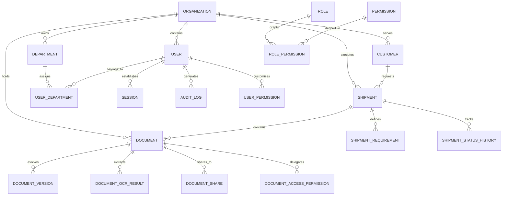

# TML – TEXT MINING LIBRARY
## THIẾT KẾ CƠ SỞ DỮ LIỆU (DATABASE DESIGN SPECIFICATION)

---

### 1. TỔNG QUAN HỆ CƠ SỞ DỮ LIỆU

Hệ thống cơ sở dữ liệu TML Logistics được thiết kế theo chuẩn quan hệ 3NF (Third Normal Form) sử dụng **Prisma ORM 6.4.1**, hỗ trợ hai hệ quản trị cơ sở dữ liệu chính:
- **Môi trường Development & Local Testing:** SQLite (`file:./dev.db`).
- **Môi trường Staging & Production:** PostgreSQL (chỉ cần thay đổi `provider = "postgresql"` trong `schema.prisma` và thiết lập biến môi trường `DATABASE_URL`).

Toàn bộ hệ thống bao gồm **21 Models**, được phân thành 6 phân hệ cốt lõi:
1. Phân hệ Tổ chức & Người dùng (`Organization`, `Department`, `User`, `UserDepartment`, `Position`, `UserPosition`).
2. Phân hệ Phân quyền RBAC (`Role`, `Permission`, `RolePermission`, `UserPermission`, `DepartmentPermission`).
3. Phân hệ Quản trị Lô hàng (`Customer`, `Shipment`, `ShipmentParticipant`, `ShipmentStatusHistory`, `ShipmentRequirement`).
4. Phân hệ Quản trị Chứng từ & OCR (`Document`, `DocumentVersion`, `DocumentOcrResult`, `Tag`, `DocumentTag`, `ArchiveBox`).
5. Phân hệ Bảo mật, Chia sẻ & Phiên (`Session`, `DocumentShare`, `DocumentAccessPermission`).
6. Phân hệ Nhật ký Kiểm toán & Đồng bộ (`AuditLog`, `SyncEvent`, `Notification`, `StorageObject`).

---

### 2. SƠ ĐỒ THỰC THỂ QUAN HỆ (ERD - ENTITY RELATIONSHIP DIAGRAM)

---

### 3. CHI TIẾT CÁC BẢNG DỮ LIỆU CỐT LÕI

#### 3.1. Phân hệ Quản lý Lô hàng (Shipment & Requirements)

##### Bảng `Shipment`
Quản lý thông tin tổng quan của từng lô hàng logistics:
| Cột | Kiểu dữ liệu | Ràng buộc | Mô tả |
| :--- | :--- | :--- | :--- |
| `id` | String | PRIMARY KEY, cuid() | Mã định danh lô hàng |
| `orgId` | String | FOREIGN KEY -> Organization | Thuộc tổ chức nào |
| `jobNo` | String | UNIQUE | Mã Job định danh lô hàng (e.g. `JOB-2026-001`) |
| `blNo` | String | NOT NULL | Số vận đơn đường biển / hàng không |
| `customerId` | String | FOREIGN KEY -> Customer | Khách hàng chủ hàng |
| `departmentId`| String | FOREIGN KEY -> Department, NULL | Phòng ban phụ trách |
| `mode` | String | DEFAULT 'sea' | Phương thức vận tải (`sea`, `air`, `road`) |
| `origin` | String | NOT NULL | Nơi đi / Cảng xếp hàng (POL) |
| `destination` | String | NOT NULL | Nơi đến / Cảng dỡ hàng (POD) |
| `etd` | String | NOT NULL | Ngày khởi hành dự kiến (ISO String) |
| `eta` | String | NOT NULL | Ngày cập cảng dự kiến (ISO String) |
| `status` | String | DEFAULT 'booking' | Trạng thái (`booking`, `in_transit`, `arrived`, `customs`, `delivered`, `closed`) |
| `ownerId` | String | FOREIGN KEY -> User | Nhân sự chính phụ trách lô hàng |
| `goodsDesc` | String | NULLABLE | Mô tả hàng hóa |
| `createdAt` | DateTime | DEFAULT now() | Thời điểm tạo |
| `updatedAt` | DateTime | UPDATED AT | Thời điểm cập nhật cuối |

##### Bảng `ShipmentRequirement`
Danh mục chứng từ bắt buộc (Checklist) cho từng lô hàng:
| Cột | Kiểu dữ liệu | Ràng buộc | Mô tả |
| :--- | :--- | :--- | :--- |
| `id` | String | PRIMARY KEY, cuid() | Mã yêu cầu chứng từ |
| `shipmentId` | String | FOREIGN KEY -> Shipment, CASCADE | Lô hàng liên kết |
| `docType` | String | NOT NULL | Loại chứng từ (`BL`, `INVOICE`, `PACKING_LIST`, `CUSTOMS`, `CO`, `DO`, `AN`) |
| `isMandatory` | Boolean | DEFAULT true | Có bắt buộc không |
| `status` | String | DEFAULT 'MISSING' | Trạng thái (`MISSING`, `UPLOADED`, `APPROVED`) |
| `updatedAt` | DateTime | UPDATED AT | Thời điểm cập nhật trạng thái |

##### Bảng `ShipmentStatusHistory`
Lưu vết toàn bộ tiến trình thay đổi trạng thái của lô hàng:
| Cột | Kiểu dữ liệu | Ràng buộc | Mô tả |
| :--- | :--- | :--- | :--- |
| `id` | String | PRIMARY KEY, cuid() | Mã lịch sử trạng thái |
| `shipmentId` | String | FOREIGN KEY -> Shipment, CASCADE | Lô hàng liên quan |
| `oldStatus` | String | NOT NULL | Trạng thái cũ |
| `newStatus` | String | NOT NULL | Trạng thái mới |
| `changedBy` | String | FOREIGN KEY -> User | Người thực hiện điều chỉnh |
| `changedAt` | DateTime | DEFAULT now() | Thời điểm thay đổi |
| `note` | String | NULLABLE | Ghi chú lý do thay đổi |

---

#### 3.2. Phân hệ Chứng từ & OCR (Documents & OCR)

##### Bảng `Document`
Tài liệu trung tâm trong hệ thống:
| Cột | Kiểu dữ liệu | Ràng buộc | Mô tả |
| :--- | :--- | :--- | :--- |
| `id` | String | PRIMARY KEY, cuid() | Mã chứng từ |
| `orgId` | String | FOREIGN KEY -> Organization | Thuộc tổ chức |
| `shipmentId` | String | FOREIGN KEY -> Shipment, CASCADE | Thuộc lô hàng |
| `customerId` | String | FOREIGN KEY -> Customer | Thuộc khách hàng |
| `departmentId`| String | FOREIGN KEY -> Department, NULL | Phân quyền phòng ban |
| `type` | String | NOT NULL | Mã loại chứng từ |
| `title` | String | NOT NULL | Tiêu đề hiển thị |
| `fileName` | String | NOT NULL | Tên file gốc |
| `fileSizeBytes`| Int | DEFAULT 0 | Dung lượng file (Bytes) |
| `storageKey` | String | NOT NULL | Đường dẫn/Key vật lý trong Vault |
| `docDate` | String | NOT NULL | Ngày lập chứng từ |
| `retentionUntil`| String | NULLABLE | Ngày hết hạn lưu trữ (ISO) |
| `archiveBoxId`| String | FOREIGN KEY -> ArchiveBox, NULL | Thùng lưu trữ kho vật lý |
| `editedHtml` | String | NULLABLE | Nội dung văn bản biên tập qua Tiptap |
| `isLocked` | Boolean | DEFAULT false | Cờ khóa chứng từ |
| `lockedBy` | String | NULLABLE | Người đang khóa |
| `isDeleted` | Boolean | DEFAULT false | Cờ xóa mềm |
| `deletedAt` | DateTime | NULLABLE | Thời điểm xóa mềm |
| `createdBy` | String | FOREIGN KEY -> User | Người tạo |
| `updatedBy` | String | FOREIGN KEY -> User | Người cập nhật cuối |

##### Bảng `DocumentOcrResult`
Lưu trữ kết quả bóc tách văn bản và trích xuất logistics tự động:
| Cột | Kiểu dữ liệu | Ràng buộc | Mô tả |
| :--- | :--- | :--- | :--- |
| `id` | String | PRIMARY KEY, cuid() | Mã kết quả OCR |
| `documentId` | String | FOREIGN KEY -> Document, CASCADE | Chứng từ liên kết |
| `versionId` | String | FOREIGN KEY -> DocumentVersion, NULL | Phiên bản liên kết |
| `status` | String | DEFAULT 'COMPLETED' | Trạng thái OCR (`PENDING`, `PROCESSING`, `COMPLETED`, `FAILED`) |
| `confidenceScore`| Float | DEFAULT 90.0 | Điểm tin cậy (0 - 100%) |
| `rawText` | String | NOT NULL | Toàn bộ văn bản thô bóc tách được |
| `structuredData` | String | NULLABLE | Dữ liệu JSON cấu trúc (Container, BL, Job, Invoice, POL, POD) |
| `extractedAt` | DateTime | DEFAULT now() | Thời điểm trích xuất |

##### Bảng `StorageObject`
Quản lý vật lý tập tin nhị phân trong Storage Vault:
| Cột | Kiểu dữ liệu | Ràng buộc | Mô tả |
| :--- | :--- | :--- | :--- |
| `id` | String | PRIMARY KEY, cuid() | Mã định danh đối tượng lưu trữ |
| `storageKey` | String | UNIQUE | Khóa định danh file trong kho vault |
| `bucket` | String | DEFAULT 'tml-docs' | Bucket/Kho lưu trữ |
| `mimeType` | String | NOT NULL | Loại MIME thực tế (`application/pdf`, `image/png`...) |
| `sizeBytes` | Int | NOT NULL | Kích thước nhị phân |
| `checksumSha256`| String | NULLABLE, INDEXED | Mã băm SHA-256 chống trùng lặp |
| `isEncrypted` | Boolean | DEFAULT false | Cờ mã hóa lưu trữ |
| `createdAt` | DateTime | DEFAULT now() | Thời điểm lưu kho |

---

#### 3.3. Phân hệ An ninh, Phiên & Chia sẻ (Security & Sharing)

##### Bảng `Session`
Phiên làm việc có trạng thái (Stateful Session tracking) kết hợp JWT:
| Cột | Kiểu dữ liệu | Ràng buộc | Mô tả |
| :--- | :--- | :--- | :--- |
| `id` | String | PRIMARY KEY, cuid() | Mã phiên định danh |
| `userId` | String | FOREIGN KEY -> User, CASCADE | Người dùng đăng nhập |
| `tokenHash` | String | NOT NULL, INDEXED | Mã băm SHA-256 của JWT Session Token |
| `ipAddress` | String | NULLABLE | Địa chỉ IP đăng nhập |
| `userAgent` | String | NULLABLE | Trình duyệt & thiết bị |
| `expiresAt` | DateTime | NOT NULL | Thời điểm hết hạn phiên |
| `revokedAt` | DateTime | NULLABLE | Thời điểm thu hồi phiên (Logout/Force kill) |
| `createdAt` | DateTime | DEFAULT now() | Thời điểm tạo phiên |

##### Bảng `DocumentShare`
Chia sẻ tài liệu ra ngoài hoặc nội bộ có bảo mật:
| Cột | Kiểu dữ liệu | Ràng buộc | Mô tả |
| :--- | :--- | :--- | :--- |
| `id` | String | PRIMARY KEY, cuid() | Mã liên kết chia sẻ |
| `documentId` | String | FOREIGN KEY -> Document, CASCADE | Chứng từ được chia sẻ |
| `token` | String | UNIQUE | Token bảo mật ngẫu nhiên trong link chia sẻ |
| `passwordHash`| String | NULLABLE | Mật khẩu bảo vệ (mã hóa bcrypt) |
| `expiresAt` | DateTime | NOT NULL | Thời điểm hết hạn truy cập |
| `isRevoked` | Boolean | DEFAULT false | Cờ thu hồi link chia sẻ |
| `downloadCount`| Int | DEFAULT 0 | Số lần đã tải xuống |
| `maxDownloads`| Int | NULLABLE | Giới hạn số lần tải tối đa |
| `createdBy` | String | FOREIGN KEY -> User | Người phát hành link chia sẻ |
| `createdAt` | DateTime | DEFAULT now() | Thời điểm phát hành |

