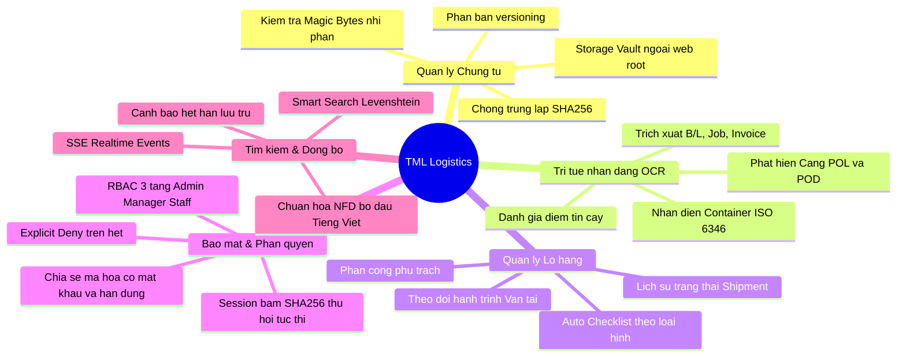

# TML – TEXT MINING LIBRARY
## TÀI LIỆU TỔNG QUAN HỆ THỐNG (PROJECT OVERVIEW)

---

### 1. GIỚI THIỆU DỰ ÁN
**TML (Text Mining Library)** là nền tảng quản trị chứng từ logistics thông minh chuyên sâu (Enterprise Logistics Document Management & Text Mining Platform), được thiết kế để giải quyết bài toán cốt lõi của các doanh nghiệp vận tải quốc tế (Freight Forwarders), đại lý hải quan và logistics 3PL/4PL:
- Xử lý khối lượng chứng từ giấy và file số khổng lồ (Vận đơn đường biển B/L, Air Waybill, Hóa đơn thương mại Commercial Invoice, Phiếu đóng gói Packing List, Tờ khai Hải quan, Chứng nhận xuất xứ C/O, Lệnh giao hàng D/O, Giấy báo hàng đến Arrival Notice).
- Tự động hóa trích xuất thông tin logistics (Mã số Container ISO 6346, số vận đơn B/L, mã Job lô hàng, số hóa đơn, cảng đi POL, cảng đến POD, ngày tàu chạy ETD, ngày cập cảng ETA) thông qua công nghệ OCR tích hợp mô hình phân tích mẫu văn bản chuyên biệt.
- Quản trị bảo mật phân tầng đa cấp (Multi-tier RBAC), kiểm soát phân quyền phòng ban (Department Isolation) nghiêm ngặt, chia sẻ chứng từ mã hóa an toàn (Secure Encrypted Document Sharing) và đồng bộ thời gian thực (Real-time SSE Sync).

---

### 2. BỐI CẢNH VÀ BÀI TOÁN KINH DOANH

| Vấn đề thực tế ngành Logistics | Giải pháp của TML Logistics |
| :--- | :--- |
| **Thất lạc và phân tán chứng từ:** Chứng từ nằm rải rác trên Zalo, email, máy tính cá nhân hoặc kho lưu trữ giấy. | **Kho lưu trữ số tập trung (Storage Vault):** Lưu trữ định danh theo băm SHA-256, gắn chặt với từng lô hàng (Shipment) và đối tác khách hàng. |
| **Nhập liệu thủ công chậm và dễ sai sót:** Nhân viên mất 15-30 phút gõ lại thông tin từ bản scan B/L, Invoice vào phần mềm. | **OCR & Heuristics Extraction Engine:** Tự động trích xuất cấu trúc hóa thông tin logistics chỉ trong vài giây, chấm điểm độ tin cậy (Confidence Score). |
| **Trùng lặp chứng từ và tải file giả mạo:** Nguy cơ tải trùng file làm sai lệch hồ sơ lô hàng; rủi ro mã độc ngụy trang đuôi `.pdf`. | **Binary Magic Bytes & Deduplication:** Kiểm tra chữ ký số nhị phân tại tầng Byte và chống trùng lặp theo mã băm SHA-256. |
| **Rò rỉ thông tin giá cước và khách hàng giữa các phòng ban:** Nhân viên kinh doanh hoặc chứng từ thấy dữ liệu nhạy cảm của phòng ban khác. | **Cách ly dữ liệu phòng ban (Department Isolation):** Cơ chế Least Privilege và Explicit Deny ngăn chặn tuyệt đối truy cập chéo trái phép. |
| **Hết hạn lưu trữ hoặc trễ hạn nộp hồ sơ hải quan:** Phát sinh tiền phạt do chậm trễ hoàn tất chứng từ. | **Checklist thông minh & Cảnh báo hạn lưu trữ (Retention Alerts):** Tự động tạo danh mục chứng từ bắt buộc cho từng loại hình vận tải và thông báo hạn nộp/lưu trữ. |

---

### 3. ĐỐI TƯỢNG NGƯỜI DÙNG & VAI TRÒ HỆ THỐNG

Hệ thống thiết kế mô hình phân quyền 3 tầng vai trò chuẩn mực:

1. **Quản trị viên hệ thống (Administrator - ADMIN):**
   - Quyền hạn toàn cầu (`GLOBAL_SCOPE`) trên toàn tổ chức.
   - Quản lý tài khoản người dùng, cấu hình phòng ban, vị trí công tác.
   - Giám sát toàn bộ nhật ký kiểm toán hệ thống (`Audit Log`), cấu hình an ninh và hạn ngạch lưu trữ.
   - Xem toàn bộ chứng từ, lô hàng và cảnh báo xuyên suốt mọi phòng ban.

2. **Quản lý phòng ban (Department Manager - MANAGER):**
   - Quản lý chứng từ, lô hàng và phân công nhân sự trong phạm vi phòng ban được phân công (ví dụ: Phòng Chứng từ - DOC, Phòng Xuất nhập khẩu - EXP, Phòng Hiện trường - OPS).
   - Phê duyệt chứng từ, phân bổ công việc, theo dõi tiến độ checklist của phòng ban.
   - Bị hạn chế truy cập đối với chứng từ thuộc phòng ban khác, trừ khi được cấp quyền chia sẻ liên phòng ban.

3. **Nhân viên nghiệp vụ (Operations / Documentation Staff - STAFF):**
   - Tải lên chứng từ, quét OCR tài liệu, chỉnh sửa nội dung văn bản scan (Tiptap Editor).
   - Theo dõi lô hàng được giao phụ trách, bổ sung các chứng từ còn thiếu theo checklist.
   - Tuân thủ nguyên tắc Least Privilege: không có quyền tạo tài khoản, không xem được nhật ký audit hệ thống, không thay đổi cấu hình bảo mật.

---

### 4. PHẠM VI CHỨC NĂNG CHÍNH (KEY CAPABILITIES)

---

### 5. TIÊU CHUẨN KỸ THUẬT VÀ TÍNH SẴN SÀNG

- **Môi trường hoạt động:** Node.js v20+ / v24 LTS, TypeScript 5+, Next.js 16 (App Router & Turbopack).
- **Cơ sở dữ liệu:** SQLite / PostgreSQL tương thích thông qua Prisma ORM 6.4.1 (21 mô hình quan hệ, khóa ngoại chặt chẽ, hỗ trợ transaction ACID).
- **Bảo mật:** Bcrypt hashing (cost factor 10), JOSE JWT (HS256), Session SHA-256 DB verification, CSRF origin/custom header validation, Memory Rate Limiting.
- **Hiện trạng kiểm thử:** Đã xây dựng và vượt qua 80/80 bài kiểm thử tự động (Unit, Security, Integration).
- **Phân loại sẵn sàng:** **STAGING READY** (Sẵn sàng triển khai thử nghiệm diện rộng trong môi trường Doanh nghiệp).

