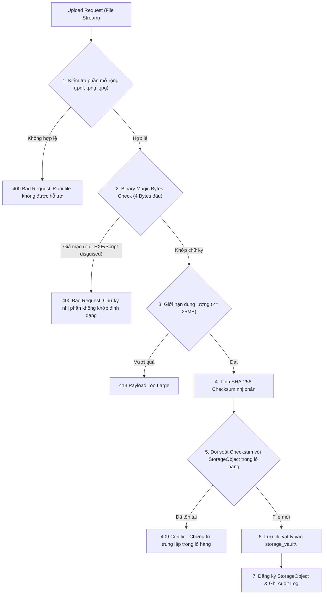

# TML – TEXT MINING LIBRARY
## TÀI LIỆU AN NINH BẢO MẬT HỆ THỐNG (SECURITY ARCHITECTURE SPECIFICATION)

---

### 1. NGUYÊN TẮC BẢO MẬT CỐT LÕI (SECURITY PRINCIPLES)

1. **Zero Trust & Defense in Depth (Phòng thủ đa tầng):** Không mặc định tin tưởng bất kỳ client nào. Mọi yêu cầu đều được xác thực và kiểm tra quyền tại tầng mạng, tầng HTTP Guard, tầng Service và tầng Cơ sở dữ liệu.
2. **Principle of Least Privilege (Quyền hạn tối thiểu):** Người dùng chỉ được cấp quyền tối thiểu cần thiết để hoàn thành công việc. Mặc định mọi thao tác nhạy cảm đều bị từ chối nếu không được cấp quyền rõ ràng.
3. **Explicit Deny Precedence (Ưu tiên từ chối rõ ràng):** Nếu có bất kỳ cấu hình `isGranted = false` ở cấp người dùng, quyền đó sẽ ghi đè mọi quyền cho phép ở cấp vai trò hoặc phòng ban.
4. **Data Isolation (Cách ly dữ liệu nghiêm ngặt):** Chứng từ, lô hàng, sự kiện đồng bộ và cảnh báo hạn lưu trữ của phòng ban này tuyệt đối không bị rò rỉ sang phòng ban khác.
5. **Fail-Closed Strategy (Đóng khi có lỗi):** Trong mọi tình huống thiếu thông tin, thiếu ngữ cảnh tài nguyên (Missing Resource Context) hoặc gặp lỗi ngoại lệ, hệ thống luôn chọn phương án an toàn nhất: **TỪ CHỐI TRUY CẬP (DENY ACCESS)**.

---

### 2. MA TRẬN KHẮC PHỤC 12 LỖ HỔNG BẢO MẬT (SEC-01 ĐẾN SEC-12)

| Mã lỗi | Mô tả nguy cơ an ninh ban đầu | Giải pháp kỹ thuật đã triển khai & kiểm thử | Trạng thái |
| :--- | :--- | :--- | :--- |
| **SEC-01** | Bỏ qua xác thực khi tải file chia sẻ (`/s/[token]/download`) | Bắt buộc kiểm tra `shareAccessToken` hợp lệ; token gắn chặt với `shareId` và tài liệu cụ thể. | **VERIFIED FIXED** |
| **SEC-02** | JWT Secret tĩnh mặc định có thể đoán trước | Ngăn chặn khởi động nếu thiếu `JWT_SECRET`; yêu cầu độ dài tối thiểu 32 ký tự, không chứa chuỗi mặc định. | **VERIFIED FIXED** |
| **SEC-03** | Thiếu cơ chế thu hồi phiên làm việc (Session Revocation) | Phiên làm việc có trạng thái trong DB; lưu `tokenHash` SHA-256; kiểm tra `revokedAt IS NULL` trên mỗi request. | **VERIFIED FIXED** |
| **SEC-04** | Rò rỉ thông tin người dùng qua thông báo lỗi đăng nhập | Thống nhất thông báo lỗi mơ hồ: *"Email hoặc mật khẩu không chính xác"*; ngăn chặn User Enumeration. | **VERIFIED FIXED** |
| **SEC-05** | Thiếu cơ chế khóa tài khoản khi bị tấn công Brute-force | Tự động khóa tài khoản 15 phút sau 5 lần đăng nhập thất bại liên tiếp; từ chối ngay cả khi nhập đúng mật khẩu. | **VERIFIED FIXED** |
| **SEC-06** | Thiếu Resource Context khi kiểm tra quyền DELETE/EDIT/DOWNLOAD | Từ chối truy cập rõ ràng nếu thiếu ngữ cảnh tài nguyên (`resource.id` hoặc `resource.departmentId`). | **VERIFIED FIXED** |
| **SEC-07** | Nhầm lẫn quyền giữa VIEW, EDIT, DELETE trong liên kết chia sẻ | Người nhận quyền VIEW tuyệt đối bị chặn không được EDIT hoặc DELETE tài liệu; phân tách rõ ràng scope. | **VERIFIED FIXED** |
| **SEC-08** | Lộ lọt dữ liệu liên phòng ban qua luồng đồng bộ SSE | Tầng SSE lọc sự kiện theo `departmentId`; nhân viên phòng ban này không thể nhận sự kiện phòng ban khác. | **VERIFIED FIXED** |
| **SEC-09** | Khởi tạo SSE Stream kéo dài không kiểm tra lại hiệu lực Session | Bổ sung kiểm tra định kỳ tính hợp lệ của phiên trong luồng SSE; tự động đóng kết nối nếu phiên bị thu hồi. | **VERIFIED FIXED** |
| **SEC-10** | Tồn tại mock database và bypass xác thực trong mã nguồn | Loại bỏ hoàn toàn mock data; toàn bộ nghiệp vụ chạy trực tiếp trên Prisma ORM với cơ sở dữ liệu thật. | **VERIFIED FIXED** |
| **SEC-11** | Thiếu cơ chế bảo vệ CSRF trên các mutating API routes | Kiểm tra tiêu đề `x-csrf-protection: 1` hoặc đối soát `Origin` khớp với `Host` trên toàn bộ phương thức ghi. | **VERIFIED FIXED** |
| **SEC-12** | Tấn công Brute-force mật khẩu liên kết chia sẻ công khai | Tích hợp bộ đệm Rate Limiter tại bộ nhớ máy chủ; khóa IP/Session sau 5 lần nhập sai mã PIN chia sẻ. | **VERIFIED FIXED** |

---

### 3. CƠ CHẾ BẢO MẬT TẬP TIN VÀ LƯU TRỮ (STORAGE VAULT DEFENSE)

#### 3.1. Chữ ký số nhị phân (Binary Magic Bytes)
Hệ thống không bao giờ tin tưởng đuôi mở rộng hoặc trường `Content-Type` do trình duyệt gửi lên, mà đọc trực tiếp các byte đầu tiên của bộ đệm nhị phân (Buffer):
- **PDF:** Bắt buộc bắt đầu bằng chuỗi byte `0x25 0x50 0x44 0x46` (`%PDF-`).
- **PNG:** Bắt buộc bắt đầu bằng `0x89 0x50 0x4E 0x47` (`‰PNG`).
- **JPEG/JPG:** Bắt buộc bắt đầu bằng `0xFF 0xD8 0xFF`.
Mọi tập tin ngụy trang (ví dụ đổi đuôi `virus.exe` hoặc script mã độc thành `.pdf`) đều bị phát hiện và từ chối tức thì.

#### 3.2. Chống trùng lặp dữ liệu (Deduplication)
- Mỗi tập tin khi tải lên được tính toán mã băm SHA-256 toàn vẹn (`checksumSha256`).
- Nếu mã băm này đã tồn tại trong lô hàng mục tiêu, hệ thống phát hiện trùng lặp và từ chối với mã lỗi 409 Conflict, bảo vệ tính toàn vẹn của hồ sơ chứng từ.

---

### 4. BẢO MẬT PHIÊN LÀM VIỆC & MẬT KHẨU (SESSION & AUTHENTICATION)

1. **Mã hóa Mật khẩu:** 
   - Sử dụng thuật toán `bcryptjs` với hệ số làm chậm (cost factor / salt rounds) là `10`.
   - Mật khẩu gốc không bao giờ được lưu trữ hoặc ghi vào log.
2. **Cấu hình Cookie Phiên:**
   - Tên cookie: `tml_session_token`.
   - Cờ `HttpOnly: true` (ngăn chặn đánh cắp qua JavaScript XSS).
   - Cờ `Secure: true` khi chạy môi trường Production (chỉ truyền qua giao thức HTTPS).
   - Cờ `SameSite: 'lax'` (chống tấn công Cross-Site Request Forgery).
   - Thời gian sống: 7 ngày (`maxAge: 7 * 24 * 3600`).
3. **Thu hồi phiên làm việc tức thì (Instant Revocation):**
   - Khi người dùng bấm Đăng xuất, hệ thống cập nhật `Session.revokedAt = now()`.
   - Ngay lập tức mọi request mang token đó đều bị từ chối, kể cả khi token JWT chưa đến thời điểm hết hạn (`exp`).
   - Quản trị viên có thể gọi hàm `revokeUserSessions(userId)` để hủy toàn bộ phiên của một người dùng khi phát hiện rủi ro an ninh.

