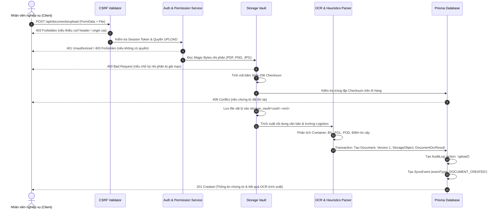

# TML – TEXT MINING LIBRARY
## TÀI LIỆU KIẾN TRÚC HỆ THỐNG (SYSTEM ARCHITECTURE)

---

### 1. TỔNG QUAN KIẾN TRÚC PHÂN TẦNG (MULTI-LAYERED ARCHITECTURE)

Hệ thống TML được xây dựng theo kiến trúc phân tầng chuẩn Enterprise (N-Tier Architecture), tách bạch rõ ràng giữa tầng hiển thị giao diện (Presentation Layer), tầng trung gian định tuyến & bảo vệ (Middleware & Guard Layer), tầng xử lý nghiệp vụ logistics (Business Services Layer), tầng trích xuất thông minh (OCR & Heuristics Engine), tầng dữ liệu quan hệ (Prisma ORM & SQLite/Postgres) và tầng kho lưu trữ nhị phân an toàn (Storage Vault).

```mermaid
flowchart TD
    subgraph ClientLayer ["1. Presentation Layer (Client)"]
        UI["Next.js React 19 Client Components"]
        Tiptap["Rich Text Editor (Tiptap)"]
        Tess["Tesseract.js Client OCR"]
        SSEClient["SSE Event Listener (Realtime)"]
    end

    subgraph SecurityLayer ["2. Security & Guard Layer"]
        CSRF["CSRF Validator (x-csrf-protection & Origin)"]
        RateLimiter["Rate Limiter (Brute-force protection)"]
        SessionGuard["Session Validator (Token Hash in DB)"]
        PermService["PermissionService (RBAC + Explicit Deny)"]
    end

    subgraph BusinessLayer ["3. Business Logic & Processing Layer"]
        DocService["Document Management & Versioning"]
        ShipService["Shipment & Auto Checklist Engine"]
        SearchEngine["Smart Search (Levenshtein + NFD Accent Normalization)"]
        AlertService["Retention & Expiration Alert Engine"]
        ShareService["Encrypted Share Service (Token + Expiration)"]
        SyncService["SSE Synchronization Dispatcher"]
    end

    subgraph OCREngine ["4. OCR & Intelligent Text Mining"]
        MagicBytes["Binary Magic Bytes Validator"]
        TextExtractor["Text Chunk Stream Reader"]
        LogisticsParser["Logistics Regex & Heuristics (ISO 6346, BL, POL, POD)"]
        ConfScorer["Confidence Scoring Algorithm"]
    end

    subgraph PersistenceLayer ["5. Persistence & Storage Layer"]
        PrismaORM["Prisma ORM 6.4.1 Client"]
        RelationalDB["Relational DB (SQLite / PostgreSQL) - 21 Models"]
        StorageVault["Storage Vault (Local Disk / S3 Object Store)"]
    end

    ClientLayer --> SecurityLayer
    SecurityLayer --> BusinessLayer
    BusinessLayer --> OCREngine
    BusinessLayer --> PersistenceLayer
    OCREngine --> PersistenceLayer
```

---

### 2. CÁC TẦNG THÀNH PHẦN CHI TIẾT

#### 2.1. Presentation Layer (Giao diện người dùng)
- **Framework:** Next.js 16.4.3 App Router kết hợp Turbopack và React 19.
- **Styling & Components:** Tailwind CSS, shadcn/ui, Lucide Icons, Dark/Light theme (`next-themes`).
- **Xử lý tài liệu tại Client:**
  - `Tiptap Editor`: Soạn thảo và chỉnh sửa văn bản rich-text của chứng từ đã OCR với lịch sử snapshot thời gian thực.
  - `Client OCR Preview`: Cho phép quét trực tiếp camera hoặc tải ảnh lên để nhận diện sơ bộ qua Tesseract.js trước khi gửi lên máy chủ lưu trữ.

#### 2.2. Security & Guard Layer (Tầng An ninh & Xác thực)
- **CSRF Defense:** Mọi yêu cầu ghi dữ liệu (POST, PUT, PATCH, DELETE) bắt buộc phải có tiêu đề `x-csrf-protection: 1` hoặc `Origin` khớp với `Host`. Các yêu cầu vi phạm bị từ chối ngay với mã lỗi 403 Forbidden.
- **Session Integrity:** Token được ký bằng thư viện JOSE (thuật toán HS256), nhưng phiên làm việc máy chủ chỉ được coi là hợp lệ khi băm SHA-256 của token tồn tại trong bảng `Session`, chưa hết hạn và chưa bị thu hồi (`revokedAt IS NULL`).
- **Mô hình phân quyền 3 tầng:**
  - Tầng 1: Vai trò (`Role` - ADMIN, MANAGER, STAFF).
  - Tầng 2: Phòng ban (`Department` - DOC, EXP, OPS, ACC...).
  - Tầng 3: Quyền cá nhân (`UserPermission`) với nguyên tắc bất biến: **Explicit Deny luôn ghi đè Allow**.

#### 2.3. Business Services Layer (Tầng Nghiệp vụ Logistics)
- **Document Management:** Quản lý vòng đời chứng từ (Upload, Download, Phân loại, Gắn thẻ, Phiên bản, Khóa chỉnh sửa, Xóa an toàn).
- **Shipment Management:** Quản lý hồ sơ lô hàng quốc tế (Đường biển, Đường hàng không, Đường bộ). Tự động khởi tạo Checklist danh mục chứng từ bắt buộc (`ShipmentRequirement`) dựa trên phương thức vận chuyển và hướng xuất/nhập khẩu.
- **Shipment Status History:** Ghi vết tự động toàn bộ thay đổi trạng thái lô hàng với người thay đổi và lý do điều chỉnh (`ShipmentStatusHistory`).
- **Intelligent Search Engine:** 
  - Khử dấu tiếng Việt chuẩn NFD (`normalize`).
  - Tìm kiếm mờ sai số Levenshtein khoảng cách $D \le 2$.
  - Lọc bảo mật bắt buộc: chỉ tìm kiếm trên tập hợp chứng từ và lô hàng mà người dùng có quyền truy cập theo vai trò và phòng ban.
- **Retention Alerts:** Cơ chế quét thời hạn lưu trữ chứng từ theo quy định hải quan/pháp luật. Cảnh báo tự động được phân lập nghiêm ngặt theo phòng ban (`Department Data Isolation`).

#### 2.4. OCR & Intelligent Text Mining Engine
- **Binary Signature (Magic Bytes):** Đọc 4 byte đầu tiên của tập tin để xác nhận định dạng thực tế (`%PDF-`, PNG `89 50 4E 47`, JPEG `FF D8 FF`), chặn đứng nguy cơ tải lên mã độc ngụy trang đuôi file.
- **SHA-256 Deduplication:** Tính toán mã băm SHA-256 của tập tin. Nếu tập tin đã tồn tại trong cùng lô hàng, máy chủ trả về mã lỗi 409 Conflict nhằm tránh lãng phí dung lượng và sai lệch chứng từ.
- **Logistics Heuristics Parser:**
  - Nhận diện số Container ISO 6346 (4 chữ cái + 7 chữ số) hỗ trợ định dạng có hoặc không có dấu cách/gạch ngang.
  - Nhận diện số vận đơn B/L (`BILL OF LADING NO: ...`, `B/L NO: ...`).
  - Nhận diện mã Job lô hàng, số hóa đơn Commercial Invoice.
  - Nhận diện Cảng bốc hàng (POL) và Cảng dỡ hàng (POD) quốc tế.
  - Tính điểm tin cậy `confidenceScore` (0 - 100%) và lưu trữ vào `DocumentOcrResult`.

#### 2.5. Persistence & Storage Vault Layer
- **Relational Database:** 21 models Prisma, ràng buộc khóa ngoại (Foreign Keys), chỉ mục tìm kiếm (Indexes), hỗ trợ transaction toàn vẹn.
- **Storage Vault:** Thư mục lưu trữ vật lý độc lập nằm ngoài web root (`storage_vault/`), đặt tên file theo mã định danh duy nhất (UUID/Key ngẫu nhiên) để ngăn chặn tấn công Direct Object Reference (IDOR) qua đường dẫn URL trực tiếp.

---

### 3. SƠ ĐỒ LUỒNG DỮ LIỆU TẢI LÊN CHỨNG TỪ (DOCUMENT UPLOAD DATA FLOW)

