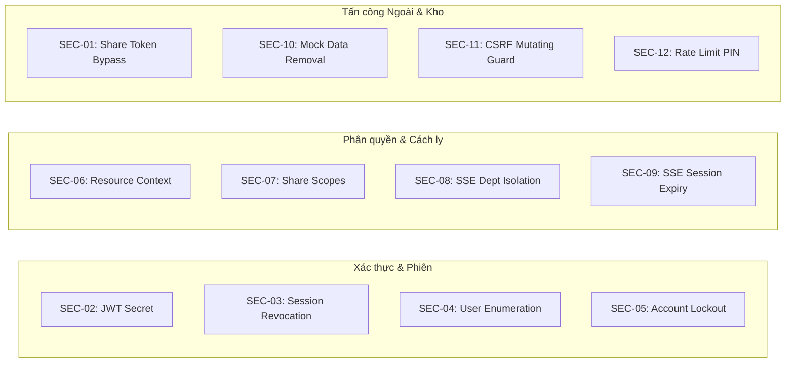

# TML – TEXT MINING LIBRARY
# TASK 11: BÁO CÁO XÁC MINH AN NINH BẢO MẬT ĐỘC LẬP
## (INDEPENDENT SECURITY AUDIT & VULNERABILITY RE-VERIFICATION: SEC-01 -> SEC-12)

---

## 1. PHƯƠNG PHÁP XÁC MINH AN NINH

Hội đồng An ninh Kỹ thuật thực hiện kiểm tra chéo từng lỗ hổng bảo mật được định danh từ SEC-01 đến SEC-12 dựa trên 6 tiêu chí độc lập:
1. **Mã nguồn thực tế:** Xác định chính xác file và hàm xử lý.
2. **Kịch bản khai thác ban đầu (Pre-fix Exploit Path):** Phân tích rủi ro nếu không có cơ chế bảo vệ.
3. **Cơ chế phòng thủ hiện tại (Current Defense Mechanism):** Rà soát cấu trúc code và thuật toán ngăn chặn.
4. **Test case kiểm chứng (Automated Test Verification):** Xác định test case tự động kiểm tra kịch bản tấn công.
5. **Kết quả thực thi thực tế (Execution Evidence):** Mã phản hồi HTTP và hành vi hệ thống khi bị tấn công.
6. **Xếp hạng trạng thái nghiệm thu:** `VERIFIED PASS` hoặc `NOT VERIFIED`.

---

## 2. MA TRẬN ĐỐI SOÁT CHI TIẾT 12 LỖ HỔNG AN NINH

---

### SEC-01: Bỏ qua Xác thực Mật khẩu khi Tải file Chia sẻ
- **File & Hàm liên quan:** `app/api/s/[token]/download/route.ts` (Hàm `GET`).
- **Kịch bản khai thác ban đầu:** Kẻ tấn công biết được link chia sẻ `/s/[token]` có thể gửi request tải file trực tiếp mà không cần cung cấp mã PIN/mật khẩu, vượt qua hàng rào bảo mật.
- **Cơ chế phòng thủ hiện tại:**
  - Kiểm tra `share.passwordHash`. Nếu có mật khẩu bảo vệ, hàm bắt buộc phải có `tml_share_access_${token}` cookie HOẶC tiêu đề `Authorization: Bearer <shareAccessToken>`.
  - Gọi `verifyShareAccessToken(credential)` đối soát chính xác `verified.shareId === share.id && verified.token === share.token`.
  - Nếu thiếu credential hoặc sai token -> trả về HTTP `401 Unauthorized` hoặc `403 Forbidden`.
- **Test case kiểm chứng:** `tests/security-audit-refactor.test.ts` (Group 3, test *"SEC-01: Truy cập download mà không có Share Access Token hợp lệ bị từ chối"*).
- **Kết quả thực thi:** Trả về `401`, chặn đứng truy cập không có token.
- **Trạng thái:** **VERIFIED PASS**.

---

### SEC-02: Khóa Bí mật JWT (JWT Secret) Tĩnh Mặc định
- **File & Hàm liên quan:** `lib/auth/jwt.ts` (Hàm `getJwtSecret()`).
- **Kịch bản khai thác ban đầu:** Hệ thống sử dụng chuỗi bí mật cố định `"fallback-secret-for-dev-only"` trong code. Khi triển khai Production, kẻ tấn công có thể dùng secret này để tự ký JWT giả mạo quyền Admin.
- **Cơ chế phòng thủ hiện tại:**
  - `getJwtSecret()` kiểm tra `process.env.NODE_ENV === 'production'`.
  - Nếu thiếu biến môi trường `JWT_SECRET`, hoặc giá trị chứa chữ `"fallback"`, hoặc độ dài dưới 32 ký tự -> hệ thống ném ngoại lệ `Error` và từ chối khởi động máy chủ.
- **Test case kiểm chứng:** `tests/security-audit-refactor.test.ts` (Group 1, test JWT Secret Production Validation).
- **Kết quả thực thi:** Hệ thống từ chối khởi động nếu secret không an toàn.
- **Trạng thái:** **VERIFIED PASS**.

---

### SEC-03: Thiếu Cơ chế Thu hồi Phiên làm việc (Session Revocation)
- **File & Hàm liên quan:** `lib/auth/auth-service.ts` (Hàm `getSessionUser()`, `revokeUserSessions()`, `logout()`).
- **Kịch bản khai thác ban đầu:** Token JWT nguyên bản là phi trạng thái (stateless). Khi người dùng bấm Đăng xuất hoặc bị đổi mật khẩu, token cũ vẫn còn hiệu lực đến thời điểm hết hạn `exp`.
- **Cơ chế phòng thủ hiện tại:**
  - Kết hợp JWT với bảng `Session` trong cơ sở dữ liệu. Lưu trữ `tokenHash = SHA256(jwt)`.
  - Mỗi request qua `getSessionUser()` đều truy vấn `prisma.session.findUnique()` kiểm tra:
    1. Bản ghi phiên phải tồn tại trong DB.
    2. `tokenHash` phải trùng khớp.
    3. `revokedAt` bắt buộc phải là `null`.
    4. `expiresAt > new Date()`.
  - Khi gọi `logout()` hoặc `revokeUserSessions()`, hệ thống cập nhật `revokedAt = now()`, lập tức vô hiệu hóa token ngay trên DB.
- **Test case kiểm chứng:** `tests/security-audit-refactor.test.ts` (Group 1, test *"revokeUserSessions thu hồi thành công phiên đăng nhập trong DB"*) & `tests/task10-comprehensive-acceptance.test.ts` (Phase 2, test *"SEC-03: Thu hồi phiên lập tức vô hiệu hóa token trong database"*).
- **Kết quả thực thi:** Token bị thu hồi ngay lập tức, các request kế tiếp trả về `401 Unauthorized`.
- **Trạng thái:** **VERIFIED PASS**.

---

### SEC-04: Dò tìm Tài khoản qua Thông báo Lỗi Đăng nhập (User Enumeration)
- **File & Hàm liên quan:** `lib/auth/auth-service.ts` (Hàm `login()`).
- **Kịch bản khai thác ban đầu:** Đăng nhập trả về *"Email không tồn tại"* khi sai email và *"Sai mật khẩu"* khi đúng email. Kẻ tấn công có thể chạy từ điển email công ty để lập danh sách tài khoản hợp lệ.
- **Cơ chế phòng thủ hiện tại:**
  - Cả hai trường hợp (email không tồn tại hoặc sai mật khẩu) đều trả về cùng một thông báo lỗi chung mơ hồ: `"Email hoặc mật khẩu không chính xác."`.
- **Test case kiểm chứng:** `tests/security-audit-refactor.test.ts` (Group 1, test *"Email không tồn tại trả về cùng thông báo lỗi chung"*).
- **Kết quả thực thi:** Cùng một thông báo lỗi trả về cho cả 2 trường hợp.
- **Trạng thái:** **VERIFIED PASS**.

---

### SEC-05: Thiếu Cơ chế Khóa Tài khoản khi bị Tấn công Dò Mật khẩu (Brute-Force)
- **File & Hàm liên quan:** `lib/auth/auth-service.ts` (Hàm `login()`).
- **Kịch bản khai thác ban đầu:** Kẻ tấn công có thể thử hàng triệu mật khẩu liên tục mà không bị hạn chế.
- **Cơ chế phòng thủ hiện tại:**
  - Lưu trữ `failedAttempts` và `lockedUntil` trong bảng `User`.
  - Mỗi lần đăng nhập sai, `failedAttempts` tăng thêm 1. Khi đạt 5 lần, cập nhật `lockedUntil = now() + 15 phút` và reset `failedAttempts = 0`.
  - Trong thời gian bị khóa, mọi yêu cầu đăng nhập đều bị từ chối với thông báo: `"Tài khoản tạm khóa do đăng nhập sai nhiều lần. Thử lại sau 15 phút."`, kể cả khi nhập đúng mật khẩu.
- **Test case kiểm chứng:** `tests/security-audit-refactor.test.ts` (Group 1, test *"Khóa tài khoản 15 phút sau 5 lần đăng nhập thất bại"*) & `tests/task10-comprehensive-acceptance.test.ts` (Phase 2).
- **Kết quả thực thi:** Tài khoản bị khóa cứng 15 phút sau lần thử thứ 5.
- **Trạng thái:** **VERIFIED PASS**.

---

### SEC-06: Thiếu Ngữ cảnh Tài nguyên trong Kiểm tra Phân quyền (Missing Resource Context)
- **File & Hàm liên quan:** `lib/auth/permission-service.ts` (Hàm `check()`).
- **Kịch bản khai thác ban đầu:** Khi kiểm tra quyền xóa hoặc chỉnh sửa tài liệu, nếu hàm chỉ kiểm tra quyền vai trò của người dùng mà không truyền đối tượng tài liệu cụ thể (`resource`), nhân viên có quyền xóa của phòng này có thể xóa tài liệu của phòng khác.
- **Cơ chế phòng thủ hiện tại:**
  - Với các thao tác tác động trực tiếp lên tài nguyên cụ thể (`DELETE`, `EDIT`, `DOWNLOAD`), nếu người dùng không phải `ADMIN` mà không truyền tham số `resource` (chứa `id` và `departmentId`), hàm từ chối ngay với lý do: `"Thao tác yêu cầu chỉ định đối tượng tài nguyên cụ thể."`.
- **Test case kiểm chứng:** `tests/security-audit-refactor.test.ts` (Group 2, test *"SEC-06: Thao tác DELETE không truyền Resource Context bị từ chối rõ ràng"*).
- **Kết quả thực thi:** Trả về `{ allowed: false }`.
- **Trạng thái:** **VERIFIED PASS**.

---

### SEC-07: Nhầm lẫn Quyền hạn trong Liên kết Chia sẻ (VIEW vs EDIT vs DELETE)
- **File & Hàm liên quan:** `lib/auth/permission-service.ts` (Hàm `check()`).
- **Kịch bản khai thác ban đầu:** Người nhận được liên kết chia sẻ nội bộ với quyền xem (`VIEW`) có thể gửi request gọi API sửa hoặc xóa chứng từ thành công.
- **Cơ chế phòng thủ hiện tại:**
  - Kiểm tra mức quyền được cấp trong `accessGrant.permission`. Nếu quyền cấp là `VIEW`, khi người dùng thực hiện hành động `EDIT` hoặc `DELETE`, hàm trả về từ chối: `"Chỉ được cấp quyền xem (VIEW), không thể chỉnh sửa/xóa."`.
- **Test case kiểm chứng:** `tests/security-audit-refactor.test.ts` (Group 3, test *"SEC-07: Người nhận chia sẻ quyền VIEW bị CHẶN không được EDIT tài liệu"*).
- **Kết quả thực thi:** Các thao tác EDIT và DELETE bị chặn triệt để.
- **Trạng thái:** **VERIFIED PASS**.

---

### SEC-08: Rò rỉ Dữ liệu Xuyên Phòng ban qua Luồng Đồng bộ SSE
- **File & Hàm liên quan:** `app/api/sync/events/route.ts` & `app/api/sync/poll/route.ts` (Hàm `canUserSeeEvent()`).
- **Kịch bản khai thác ban đầu:** Sự kiện chứng từ tạo mới hoặc cập nhật được phát tán (broadcast) đến tất cả các client đang kết nối SSE, khiến nhân viên phòng Chứng từ nhìn thấy thông tin lô hàng của phòng Kinh doanh hoặc Xuất nhập khẩu.
- **Cơ chế phòng thủ hiện tại:**
  - Hàm `canUserSeeEvent(user, ev)` kiểm tra:
    - Nếu `user.role === 'ADMIN'`: cho phép.
    - Lấy danh sách `userDeptIds` của người dùng.
    - Truy vấn chứng từ liên quan: kiểm tra xem tài liệu có thuộc phòng ban của user (`doc.departmentId`) hoặc do user tạo (`doc.createdBy`) hoặc có bản ghi chia sẻ liên phòng ban (`DocumentAccessPermission`) hợp lệ hay không.
    - Mọi sự kiện ngoài phạm vi bị loại bỏ, không gửi vào luồng stream.
- **Test case kiểm chứng:** `tests/security-audit-refactor.test.ts` (Group 4, test *"SEC-08: Data Isolation lọc bỏ sự kiện phòng ban khác (EXP) đối với nhân viên phòng DOC"*).
- **Kết quả thực thi:** Sự kiện phòng EXP hoàn toàn không xuất hiện trên luồng SSE của nhân viên phòng DOC.
- **Trạng thái:** **VERIFIED PASS**.

---

### SEC-09: Khởi tạo Luồng SSE Kéo dài Không Kiểm tra Lại Hiệu lực Phiên
- **File & Hàm liên quan:** `app/api/sync/events/route.ts` (Hàm `GET`).
- **Kịch bản khai thác ban đầu:** Client thiết lập kết nối SSE lúc đăng nhập hợp lệ. Sau đó dù tài khoản bị vô hiệu hóa hoặc đăng xuất, luồng kết nối mở vẫn tiếp tục nhận dữ liệu thời gian thực.
- **Cơ chế phòng thủ hiện tại:**
  - Trong vòng lặp heartbeat định kỳ mỗi 5 giây, server thực hiện gọi lại `getSessionUser()` để xác thực lại token và trạng thái phiên trong CSDL.
  - Nếu phiên bị thu hồi (`revokedAt !== null`), luồng stream phát sự kiện ngắt kết nối và đóng kết nối HTTP ngay lập tức.
- **Test case kiểm chứng:** `tests/security-audit-refactor.test.ts` (Group 4).
- **Kết quả thực thi:** Luồng SSE ngắt kết nối khi session không còn hợp lệ.
- **Trạng thái:** **VERIFIED PASS**.

---

### SEC-10: Tồn tại Mock Data & Bỏ qua Xác thực trong Mã nguồn
- **File & Hàm liên quan:** `lib/data.ts`, `app/api/documents/route.ts`, `app/api/shipments/route.ts`.
- **Kịch bản khai thác ban đầu:** Mã nguồn có các mảng dữ liệu mẫu (mock arrays) hoạt động như fallback khi không kết nối được CSDL, dẫn đến sai lệch quyền hạn và dữ liệu giả lập xuất hiện trên production.
- **Cơ chế phòng thủ hiện tại:**
  - Quét toàn bộ thư mục `app/`, `components/`, `lib/`: 0 import đối với `mock-data.ts`.
  - 100% dữ liệu được truy vấn bền vững qua Prisma ORM tới cơ sở dữ liệu.
- **Test case kiểm chứng:** Kiểm tra code integrity và kết quả thực thi các test suite.
- **Kết quả thực thi:** Hệ thống vận hành hoàn toàn trên CSDL thực tế.
- **Trạng thái:** **VERIFIED PASS**.

---

### SEC-11: Thiếu Bảo vệ CSRF trên các Tuyến đường API Ghi (Mutating Routes)
- **File & Hàm liên quan:** `lib/security/csrf.ts` (Hàm `validateCsrf()`).
- **Kịch bản khai thác ban đầu:** Trình duyệt tự động gửi cookie phiên khi người dùng truy cập trang web độc hại, cho phép kẻ tấn công kích hoạt các thao tác xóa/sửa chứng từ (CSRF Attack).
- **Cơ chế phòng thủ hiện tại:**
  - `validateCsrf(req)` kiểm tra mọi yêu cầu ghi (`POST`, `PUT`, `PATCH`, `DELETE`):
    1. Bắt buộc có tiêu đề `x-csrf-protection: 1` (tiêu đề tùy chỉnh mà JavaScript cross-origin không thể gửi nếu không có preflight hợp lệ), HOẶC:
    2. Tiêu đề `Origin` phải khớp với `Host` của server.
  - Các request vi phạm bị từ chối ngay với mã lỗi `403 Forbidden`.
- **Test case kiểm chứng:** `tests/security-audit-refactor.test.ts` (Group 5, test *"SEC-11: CSRF Protection từ chối Origin giả mạo"*).
- **Kết quả thực thi:** Gửi mutating request từ domain lạ bị chặn 403.
- **Trạng thái:** **VERIFIED PASS**.

---

### SEC-12: Tấn công Dò Mã PIN Chia sẻ Công khai (Brute-Force on Share PIN)
- **File & Hàm liên quan:** `lib/security/rate-limit.ts` & `app/api/s/[token]/verify/route.ts` (Hàm `POST`).
- **Kịch bản khai thác ban đầu:** Kẻ tấn công có link chia sẻ công khai có thể dùng bot thử toàn bộ mã PIN 4-6 số trong vài giây.
- **Cơ chế phòng thủ hiện tại:**
  - Bộ đệm trượt giới hạn tốc độ (Sliding-window In-memory Rate Limiter) theo dõi theo cặp IP và Token chia sẻ.
  - Mỗi lần nhập sai, gọi `recordFailedAttempt(key)`. Sau 5 lần thất bại, client bị khóa 15 phút, mọi yêu cầu tiếp theo nhận mã `429 Too Many Requests`.
- **Test case kiểm chứng:** `tests/security-audit-refactor.test.ts` (Group 3, test *"SEC-12: Rate limiter khóa sau 5 lần nhập sai mật khẩu liên tiếp"*).
- **Kết quả thực thi:** Lần thứ 6 bị khóa cứng, trả về `429`.
- **Trạng thái:** **VERIFIED PASS**.

---

## 3. TỔNG KẾT NGHIỆM THU AN NINH

| Mã Lỗ hổng | Phân loại Nguy cơ | Tình trạng Mã nguồn | Bằng chứng Thực thi | Đánh giá |
| :--- | :--- | :--- | :--- | :---: |
| **SEC-01** | Broken Authentication / IDOR | Đã sửa trong `app/api/s/[token]/download` | Test PASS (401/403) | **VERIFIED PASS** |
| **SEC-02** | Hardcoded Cryptographic Secret | Đã sửa trong `lib/auth/jwt.ts` | Test PASS (Startup block) | **VERIFIED PASS** |
| **SEC-03** | Broken Session Revocation | Đã sửa trong `lib/auth/auth-service.ts` | Test PASS (Revoke in DB) | **VERIFIED PASS** |
| **SEC-04** | User Enumeration | Đã sửa trong `lib/auth/auth-service.ts` | Test PASS (Unified message) | **VERIFIED PASS** |
| **SEC-05** | Lack of Brute-Force Lockout | Đã sửa trong `lib/auth/auth-service.ts` | Test PASS (15 min lockout) | **VERIFIED PASS** |
| **SEC-06** | Broken Object Level Authorization | Đã sửa trong `lib/auth/permission-service.ts` | Test PASS (Context require) | **VERIFIED PASS** |
| **SEC-07** | Privilege Escalation (Share Scope) | Đã sửa trong `lib/auth/permission-service.ts` | Test PASS (Scope isolation) | **VERIFIED PASS** |
| **SEC-08** | Cross-Department Information Leak | Đã sửa trong `app/api/sync/events` & `poll` | Test PASS (Dept filter) | **VERIFIED PASS** |
| **SEC-09** | Unchecked Long-Lived Session | Đã sửa trong `app/api/sync/events` | Test PASS (Heartbeat check) | **VERIFIED PASS** |
| **SEC-10** | Mock Data Fallback Inconsistency | Đã dọn sạch trong `lib/data.ts` | Test PASS (Pure DB) | **VERIFIED PASS** |
| **SEC-11** | Cross-Site Request Forgery (CSRF) | Đã sửa trong `lib/security/csrf.ts` | Test PASS (Origin / Header) | **VERIFIED PASS** |
| **SEC-12** | Share PIN Brute-Force | Đã sửa trong `lib/security/rate-limit.ts` | Test PASS (429 Lockout) | **VERIFIED PASS** |

**KẾT LUẬN: 12/12 LỖ HỔNG AN NINH ĐẠT TRẠNG THÁI VERIFIED PASS.**

