# TML – TEXT MINING LIBRARY
## KẾ HOẠCH KIỂM THỬ HỆ THỐNG (SYSTEM TEST PLAN)

---

### 1. MỤC TIÊU VÀ PHẠM VI KIỂM THỬ

Kế hoạch kiểm thử này được thiết lập nhằm xác thực toàn diện tính toàn vẹn, bảo mật, hiệu năng và độ chính xác nghiệp vụ của hệ thống **TML – Text Mining Library**, đảm bảo đáp ứng đầy đủ các tiêu chuẩn nghiệm thu khắt khe của một hệ thống quản trị logistics thực tế:
1. **Kiểm thử An ninh & Xác thực (Security & Authentication Testing):** Đảm bảo khắc phục 100% 12 lỗ hổng bảo mật SEC-01 đến SEC-12.
2. **Kiểm thử Phân quyền & Cách ly dữ liệu (Authorization & Data Isolation Testing):** Đảm bảo vai trò ADMIN, MANAGER, STAFF hoạt động đúng phạm vi, không rò rỉ dữ liệu xuyên phòng ban.
3. **Kiểm thử Nghiệp vụ Chứng từ & OCR (Document & OCR Testing):** Xác thực cơ chế Magic Bytes, băm SHA-256 chống trùng lặp, bóc tách chính xác các trường logistics (Container ISO 6346, B/L, POL, POD, Invoice).
4. **Kiểm thử Tích hợp Luồng Lô hàng & Tìm kiếm (Shipment & Smart Search Testing):** Xác thực tự động sinh checklist chứng từ, lịch sử trạng thái và thuật toán tìm kiếm mờ không dấu tiếng Việt.
5. **Kiểm thử Tính sẵn sàng Vận hành (Operational Readiness Testing):** Xác thực endpoint `/api/health`, kết nối database và quyền ghi kho lưu trữ vault.

---

### 2. PHÂN TẦNG VÀ MA TRẬN BÀI KIỂM THỬ

Hệ thống kiểm thử tự động của TML được chia thành 3 bộ test chính với tổng cộng **80 Test Cases**:

```mermaid
graph TD
    TestSuite["Tổng thể Bộ Kiểm thử TML (80 Test Cases)"]
    TS1["Suite 1: Enterprise System Test (13 Tests)"]
    TS2["Suite 2: Security Audit & Refactor Test (34 Tests)"]
    TS3["Suite 3: Business Integration & Logistics Test (33 Tests)"]

    TestSuite --> TS1
    TestSuite --> TS2
    TestSuite --> TS3

    TS1 --> G1["Password Bcrypt & Auth"]
    TS1 --> G2["Admin Global Scope"]
    TS1 --> G3["Staff Least Privilege"]
    TS1 --> G4["Explicit Deny Rules"]
    TS1 --> G5["Manager Dept Scope"]
    TS1 --> G6["Cross-Dept Sharing"]

    TS2 --> S1["Session SHA256 & Revocation"]
    TS2 --> S2["Lockout after 5 failures"]
    TS2 --> S3["Resource Context Enforcement"]
    TS2 --> S4["Encrypted Share Tokens"]
    TS2 --> S5["SSE Data Isolation"]
    TS2 --> S6["CSRF Origin & Headers"]

    TS3 --> B1["Binary Magic Bytes Validation"]
    TS3 --> B2["Storage Vault Deduplication"]
    TS3 --> B3["Logistics OCR & ISO 6346"]
    TS3 --> B4["Shipments & Auto Checklist"]
    TS3 --> B5["Levenshtein & NFD Search"]
    TS3 --> B6["Retention Expiration Alerts"]
    TS3 --> B7["System Health & Vault Probe"]
```

---

### 3. MÔI TRƯỜNG VÀ DỮ LIỆU KIỂM THỬ

#### 3.1. Cấu hình Môi trường
- **Hệ điều hành:** Windows 11 / Linux (Ubuntu 22.04 LTS).
- **Node.js:** v24.13.0 (tương thích v20+ LTS).
- **Prisma Client:** 6.4.1.
- **Cơ sở dữ liệu:** SQLite (`file:./dev.db`) có đầy đủ Foreign Key constraints.
- **Storage Vault:** Thư mục cục bộ `storage_vault/` với quyền đọc/ghi nhị phân.

#### 3.2. Tài khoản Kiểm thử Tiêu chuẩn
| Vai trò | Email | Mật khẩu | Phòng ban | Chức vụ |
| :--- | :--- | :--- | :--- | :--- |
| **ADMIN** | `admin@tml.vn` | `Tml@2026!` | Ban Giám đốc | Quản trị viên hệ thống tối cao |
| **MANAGER** | `ha.tran@tml.vn` | `Tml@2026!` | Phòng Chứng từ (DOC) | Trưởng phòng chứng từ |
| **STAFF** | `lan.pham@tml.vn` | `Tml@2026!` | Phòng Chứng từ (DOC) | Chuyên viên chứng từ |

---

### 4. TIÊU CHÍ NGHIỆM THU (ACCEPTANCE CRITERIA)

1. **Tỷ lệ Pass:** 100% (80/80 bài kiểm thử phải đạt kết quả `PASS`, không có ngoại lệ hoặc thất bại).
2. **Kiểm tra TypeScript:** `npx tsc --noEmit` hoàn thành với mã thoát 0 (Zero type errors).
3. **Next.js Production Build:** `npm run build` tạo thành công toàn bộ 38 routes tĩnh và động mà không có lỗi biên dịch.
4. **Không rò rỉ dữ liệu:** Mọi truy vấn từ tài khoản Staff hoặc Manager không bao giờ trả về chứng từ hoặc cảnh báo thuộc phòng ban khác.
5. **Kháng tấn công:** Mọi cố ý tải lên file giả mạo hoặc truy cập không có token đều phải nhận mã lỗi HTTP phù hợp (400, 401, 403, 409).

